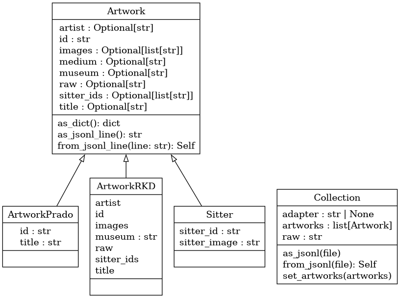

From the point of view of data management, this project has two challenges ahead:

1. A classic data acquisition problem: digesting data from different sources (RKD's collection, Prado's collection, ...)
2. A new research-specific problem: turning the data from 1. into pairs containing `sitter_id` and `sitter_image`. These are the elementary particles we are going to feed to our ML algorithm

Problem 1 has known solutions. One of them is using an adapter pattern, a concept from Object Oriented Programming.

Problem 2 forces us to think of data structures. My suggestion is to use `Artwork`, for individual records, possibly with multiple sitters on them, and `Sitter` for each of those sitters.

Eventually, a list (or iterable) of `Sitter` objects will be fed to the ML algorithm. One (or multiple) `Interface`s orchestrate this.

See diagram below:



The idea is that the **same** interface can handle all sources of data. The specific implementations for handling different input sources are delegated to the sub-classes. 

How to use:

```python
# Load the interface
interface = Interface()

# Set the desired adapter
interface.set_adapter(RKDCollection("data_rkd.xml"))
# or
interface.set_adapter(PradoCollection("data_prado.json"))

# Use it!
all_records = interface.get_records()

all_records[2].crop_faces()# Crop faces from record 2
> "Three faces cropped:
> "rkd/cropped_5534_1.jpeg"
> "rkd/cropped_5534_2.jpeg"
> "rkd/cropped_5534_3.jpeg"
all_records[2].crop_faces()[1].sitter_id # Get sitter id for face 1 in record 2
> "Willem van Oranje"
all_records[2].crop_faces()[1].sitter_image #  Get sitter image for face 1 in record 2
> "rkd/cropped_5534_1.jpeg"
```

### Adapter example
Just for pedagogical purposes.

As a proof of concept, here we solve the problem of treating equally (as numbers) two different inputs (numbers and strings representing numbers).

```python
# Superclass describing common features we want for all adapters
class Adapter:

    _data = None

    def view_data(self):
        print(self._data)

# Specific implementation for adapting integers
class IntAdapter(Adapter):

    def __init__(self, x):
        self._data = x

# Specific implementation for adapting strings
class StrAdapter(Adapter):

    def __init__(self, x):
        if x == "one":
            self._data = 1
        elif x == "two":
            self._data = 2
        else:
            self._data = 3

# Common interface for governing everything
class Interface:
    _adapter = None

    def set_adapter(self, adapter):
        self._adapter = adapter

    def view_data(self):
        self._adapter.view_data()

# Usage
interface = Interface()
interface.set_adapter(IntAdapter(1))
interface.view_data()
print("====")
interface.set_adapter(StrAdapter("two"))
interface.view_data()

# Output
> 1
> ====
> 2
```

## Alternative approaches
After discussing this idea with the engineers at the Social Sciences and Humanities section:
### Reduce complexity
If `PradoCollection` and `RKDCollection` just contain a data parser, they are just a function in disguise. Consider just using `read_prado(path)` and `read_rkd(path)`.
### Consider using `pydantic`
`pydantic` adds model validation on top of the class hierarchy.\
### Consider using `attrs`
`attrs` seems to be a lightweight alternative to `pydantic`
### Consider using `polars`
A more modern, schema + dataframe approach.
